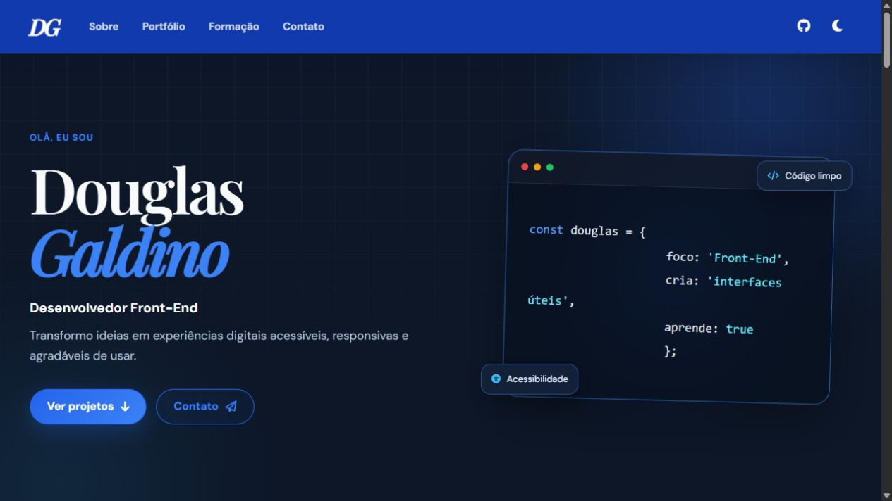

# Portfólio — Douglas Galdino

Portfólio pessoal desenvolvido para apresentar minha trajetória, meus projetos e os conhecimentos que venho construindo na área de tecnologia.



## Sobre o projeto

Este site reúne projetos pessoais e acadêmicos de desenvolvimento web e mobile. A proposta é apresentar não apenas o resultado de cada trabalho, mas também minha participação, os desafios encontrados e os aprendizados de cada experiência.

O layout foi criado a partir de um wireframe de alta fidelidade e evoluiu para uma identidade mais pessoal, acessível e responsiva.

## Funcionalidades

- Tema claro e escuro com preferência salva no navegador.
- Navegação responsiva para computador, tablet e celular.
- Carrossel infinito de tecnologias e ferramentas.
- Cards com projetos pessoais e acadêmicos.
- Modais com descrição, tecnologias, participação e aprendizados.
- Galeria de imagens com navegação por botões, teclado e gesto de deslizar.
- Formulário que prepara uma mensagem para envio por e-mail.
- Cuidados de acessibilidade, como navegação por teclado, textos alternativos e redução de movimento.

## Tecnologias e ferramentas

- HTML5
- CSS3
- JavaScript
- Git e GitHub
- VS Code
- Figma
- Font Awesome
- Prettier e EditorConfig

## Projetos apresentados

- **Dev Cloud:** landing page que marcou meus primeiros passos no desenvolvimento Front-End.
- **Pipoca Poc:** vitrine digital criada para uma necessidade real, com identidade visual alegre e responsiva.
- **EspectroCare:** plataforma acadêmica de TCC voltada ao acolhimento e à informação sobre o TEA.
- **Conversor de moedas:** aplicativo Android desenvolvido em Kotlin.
- **Consulta CEP:** aplicativo Android para consulta e organização de endereços.
- **Jokenpô:** jogo mobile criado para praticar lógica e estados da aplicação.
- **Aplicativo de login:** estudo de autenticação, formulários, navegação e integração com API.

## Estrutura do projeto

```text
Portfólio-DG/
├── assets/
│   ├── images/
│   └── projetos/
├── css/
│   ├── responsividade.css
│   └── style.css
├── js/
│   ├── carrosel.js
│   ├── main.js
│   ├── projetos.js
│   └── tema.js
├── .editorconfig
├── .prettierrc.json
└── index.html
```

## Como executar

Clone o repositório:

```bash
git clone https://github.com/Douglas-GitProjects/Portf-lio-DG.git
```

Depois, abra a pasta no VS Code e execute o `index.html` com a extensão Live Server. Também é possível abrir o arquivo diretamente no navegador.

O projeto não exige instalação de dependências.

## Padrão do código

O `.prettierrc.json` e o `.editorconfig` fazem parte do repositório de propósito. Eles mantêm a mesma indentação, largura de linha e estilo de formatação para qualquer pessoa que editar o projeto.

## Contato

- [LinkedIn](https://www.linkedin.com/in/douglasgaldinodasilva)
- [GitHub](https://github.com/Douglas-GitProjects)
- [E-mail](mailto:douglasgsilva.2512@gmail.com)
